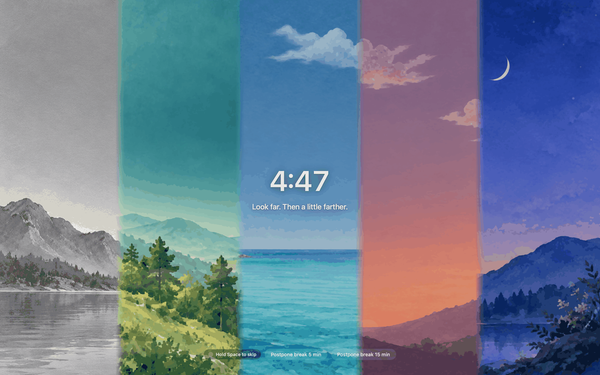

  

<h1 align="center">Pausa</h1>

  <b>Better use Pausa!</b>

  
  
  
  

  

Pausa reminds you to look away from the screen and get up and move, every once in a while. It stays quiet while you're in a meeting, watching a video, or sharing your screen. And it's free.

## Install

1. Download `Pausa-x.y.z.dmg` from [Releases](https://github.com/debidong/pausa/releases/latest) and drag Pausa to **Applications**.
2. Open it. macOS will block it the first time, because Pausa isn't signed with an Apple Developer certificate.
3. Go to **System Settings › Privacy & Security**, scroll to **Security**, and click **Open Anyway**.

That's the only time you'll need to do this.

## Contributing

PRs are welcome. Read [CONTRIBUTING.md](CONTRIBUTING.md) first; you'll sign the [CLA](CLA.md) in your first PR.

## License

Source-available under [PolyForm Shield 1.0.0](LICENSE). Free to use, including at work. Just don't use the code to build a competing product.
