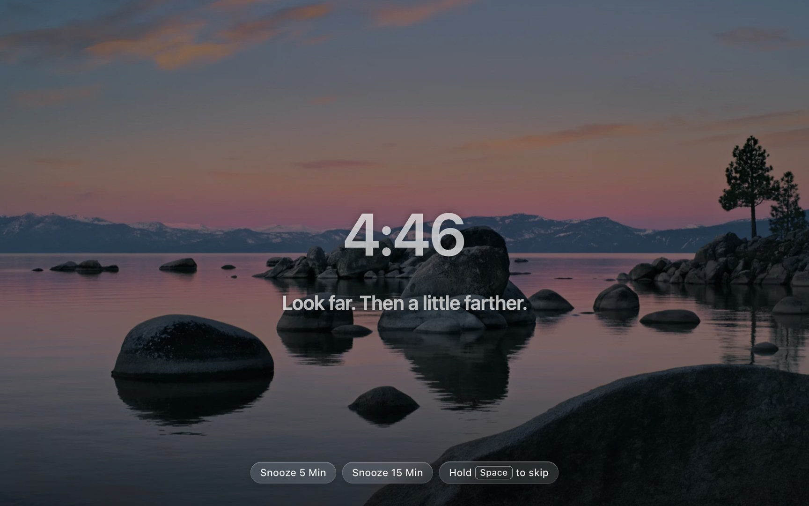

# Pausa 🪷

Did you know you have the right to look away from your screen? The Constitution doesn't say so, but your eyes do. Pausa reminds you to rest every once in a while, and stays quiet when you're in a meeting, watching a video, or sharing your screen. *Better use Pausa!*

**[Website & Interactive Preview →](https://debidong.github.io/pausa/)** · **[Download for macOS (`.dmg`)](https://github.com/debidong/pausa/releases/latest)**

macOS 13+ · Universal (`arm64` & `x86_64`) · Zero privacy permissions · Free.

For interactive break previews, zero-permission auto-pause details, and first-launch setup instructions, visit **[debidong.github.io/pausa](https://debidong.github.io/pausa/)**.

---

PRs welcome — read [CONTRIBUTING.md](CONTRIBUTING.md) and [CLA.md](CLA.md) first. Source-available under [PolyForm Shield 1.0.0](LICENSE) (free to use at home or at work; not for building a competing product).
